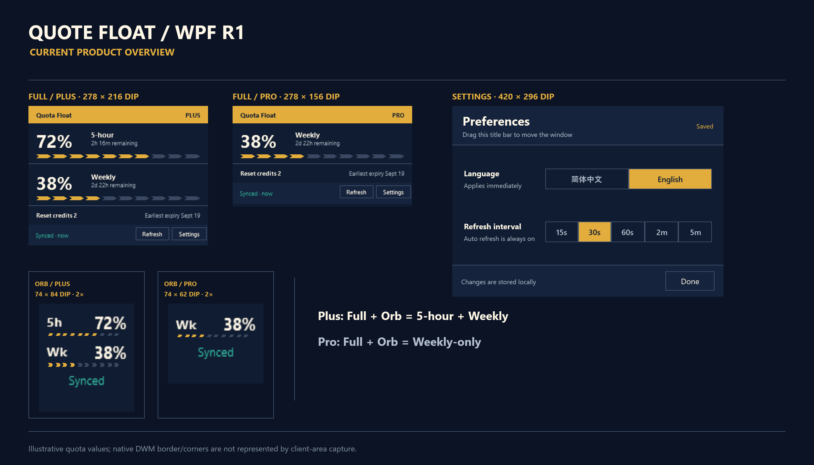
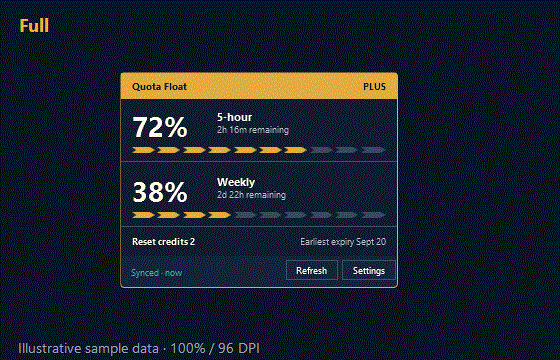

# Codex Quota Float for Windows

**Language / 语言:** English (current) · [简体中文](README.zh-CN.md)

[](https://github.com/keida/codex-quota-float/releases)

Counts all assets across R1 and R2 releases, including checksum files—not unique users/installations or R2-only downloads. Shields.io caching may delay updates.

Codex Quota Float has two separate Windows implementations: **WPF R1**, the stable line, and **Tauri R2**, a beta prerelease. Their interfaces and lifecycle differ; R2 does not replace R1.

## R2 UI preview — PRO LITE example


> **AI-generated product illustration with illustrative data; not a native application screenshot.** It does not demonstrate runtime behavior or constitute visual acceptance. The PRO LITE example depicts one returned weekly window; it does not claim that all PRO accounts return only a weekly window. R2 follows durations and values in each response. This page does not publish native R2 screenshots.

<details>
<summary>PLUS example — illustrative 5-hour and weekly windows</summary>


> AI-generated illustration with sample data, not a native screenshot or runtime/visual acceptance. The 5-hour and weekly windows are examples, not a guarantee for every PLUS account; R2 follows returned durations and values.

</details>

## Choose a release

| Line | Status | Download | SHA-256 |
| --- | --- | --- | --- |
| WPF R1 `v1.1.3` | Stable, current Latest | [Windows x64 EXE](https://github.com/keida/codex-quota-float/releases/download/v1.1.3/Quote.Float.exe) | [Release notes](https://github.com/keida/codex-quota-float/releases/tag/v1.1.3) |
| Tauri R2 `2.0.0-beta.1` | Beta prerelease; not a stable replacement | [Windows x64 EXE](https://github.com/keida/codex-quota-float/releases/download/v2.0.0-beta.1/Codex-Float-R2-2.0.0-beta.1-windows-x64.exe) · [Release page](https://github.com/keida/codex-quota-float/releases/tag/v2.0.0-beta.1) | [SHA256SUMS.txt](https://github.com/keida/codex-quota-float/releases/download/v2.0.0-beta.1/SHA256SUMS.txt) |

R2's EXE is 20,928,512 bytes; SHA-256: `5BF6AAFB87791556F543863FF7D8691CA363CFB2727A4351DB00A9C2FF36099A`. It is unsigned, unpackaged, and a custom-protocol debug-profile build—not a self-contained installer. R2 needs Windows x64, Microsoft Edge WebView2 Runtime, usable local Codex authentication, and network access. Ordinary use does not require .NET, Node.js, Rust, or Visual Studio tools. Follow your Windows or organization security policy; do not blindly bypass warnings.

## R2 quick start

1. Download the R2 EXE and `SHA256SUMS.txt` from the release above. Verify the EXE against the published checksum before running it.
2. Run the EXE. Keep a usable local Codex authentication file and network access available for quota requests; Codex Desktop itself does not need to be running.
3. If the app does not start, check that the Microsoft Edge WebView2 Runtime is installed. This beta has not been verified for clean-machine portability.

## R2 operation

- The widget starts compact at 96×96 DIP. Hover to expand quota details; leave the surface to return to compact. Settings remains open while you edit it and closes with Done or Escape.
- Refresh manually from the expanded view's header or the tray menu; the compact 96×96 surface has no Refresh button. Tray actions are Open, Refresh, and Exit. The window is configured not to add a taskbar button.
- Closing the R2 window hides it; tray Exit quits the app. R2 does not launch or monitor Codex Desktop and does not automatically exit when Codex closes.
- Successful manual quota feedback is **“Quota updated”**. Partial, stale, unavailable, and failed manual refreshes have distinct feedback. **“Sign in required”** and **“Rate limited”** describe quota availability states, not separate manual-refresh success messages. Missing fields are unknown, not zero.

## R2 Settings and data interpretation

| Setting or data | What it means |
| --- | --- |
| Appearance | System follows the Windows app-color setting; Light and Dark are also available. |
| Language | English or Simplified Chinese. |
| Refresh interval | 60, 120, or 300 seconds. On failures, backoff and any applicable server `Retry-After` can delay the next poll; a fixed interval is not guaranteed. |
| Quota windows | Durations and values come from returned data; labels do not imply billing or plan entitlements. |
| Plan badge | Returned identifiers map to `PRO LITE`, `PLUS`, `PRO (MORE)`, or `PRO (MAX)`. These are UI labels, not official billing terms or entitlement claims. |
| Token activity | Local session records feed 12 local-time buckets. Missing buckets stay blank/unknown; partial coverage makes the displayed total a lower bound. Values use K/M only. This is not a measure of subscription quota consumed, ordinary ChatGPT usage, or API usage. |
| Reset credits | Read-only information shown only when valid returned fields are available. Unknown/unavailable does not mean zero; the app does not perform a credit action. |

R2 reads local authentication data for quota requests and scans local session JSONL records for token counts. Those files can contain conversation-bearing bytes; the current source uses token-count fields and does not send session contents to a product server. The current source has no product telemetry or analytics endpoint; that is not a promise about future versions.

### R2 troubleshooting and limits

If quota is stale or unavailable, check local Codex authentication and network access; signed-out, rate-limited, partial, stale, and unavailable are different states. If startup fails, check WebView2 and follow local security policy for the unsigned beta. Broad account/provider coverage, clean-machine portability, multiple-DPI behavior, and a complete interaction matrix remain unverified. This page's AI illustration is not a native screenshot or visual acceptance. See the [R2 README](https://github.com/keida/codex-quota-float/blob/codex/r2-release/r2-tauri/README.md), [feature boundaries](https://github.com/keida/codex-quota-float/blob/codex/r2-release/r2-tauri/docs/r2/UPDATE-2026-10-17.md), and [acceptance record](https://github.com/keida/codex-quota-float/blob/codex/r2-release/r2-tauri/docs/r2/ACCEPTANCE.md).

<details>
<summary>WPF R1 visuals (not R2)</summary>





_Illustrative sample values; these are WPF R1 captures at 100% / 96 DPI, not R2 screenshots. Native DWM edge appearance is OS-composed and may differ slightly from captured boundaries._

</details>

## Stable WPF R1 — Latest download

**[Latest Release](https://github.com/keida/codex-quota-float/releases/latest)** · v1.1.3 · [Download the self-contained Windows x64 EXE](https://github.com/keida/codex-quota-float/releases/download/v1.1.3/Quote.Float.exe) · [SHA-256 in release notes](https://github.com/keida/codex-quota-float/releases/tag/v1.1.3)

Run `Quote.Float.exe` directly. No separate .NET installation is required. Verify the SHA-256 from the v1.1.3 release notes before running it. This build is currently unsigned, so Windows Defender SmartScreen may warn on first run; use the official release link above, verify the hash, and follow your Windows or organization policy. Do not bypass a security warning blindly.

## WPF R1 — core features

- **Codex-only companion:** works with the installed Codex Desktop app, can launch it when needed or observe its presence, and never closes it.
- **Full and Orb:** keep Plus or Pro quota visible, with edge placement, hover expansion, tray recovery, and topmost behavior from the WPF R1 contract.
- **English / 中文:** switch the UI and tray menu language from Settings; the selection is stored locally.
- **Local-first:** quota data is fetched only for the supported Codex usage and reset-credit views, with no chat-content collection or product analytics endpoint in the current source.

## WPF R1 — Windows requirements

- Windows x64 with the Codex Desktop app installed when using LaunchAndWatch.
- Native baseline verified at Windows 100% / 96 DPI.
- Windows 125% / 150% native DPI runtime acceptance remains **NOT VERIFIED / OUT OF R1 ACCEPTANCE SCOPE**.
- The published v1.1.3 EXE is self-contained; no separate .NET installation is required.

## WPF R1 — privacy boundary

Quote Float reads the local Codex `auth.json` under `CODEX_HOME` or the user's `.codex` directory only to obtain the access token and account-routing identifier needed for quota requests. It sends authenticated GET requests only to:

- `https://chatgpt.com/backend-api/wham/usage`
- `https://chatgpt.com/backend-api/wham/rate-limit-reset-credits`

The current source does not read chat content, define a telemetry or analytics endpoint, or write the Codex token to Quote Float preferences. Quote Float stores its language and refresh-interval preferences locally at `%LOCALAPPDATA%\QuotaFloat\preferences.json`. Optional Edge Drag diagnostics are off by default; only `QF_EDGE_DRAG_LOG` writes to the user-selected local file. That file may include timestamps, window/display bounds, and window handles; it is never auto-uploaded. Inspect and redact it before public sharing. Never attach `auth.json`, tokens, cookies, raw responses, account screenshots, or private diagnostics to a public issue.

## WPF R1 — verify the download

From the folder containing the downloaded `Quote.Float.exe`, compare its SHA-256 with the value published in the [v1.1.3 release notes](https://github.com/keida/codex-quota-float/releases/tag/v1.1.3):

```powershell
$expected = 'D3F3F2D30662B1C93D973BA68AADA0498E7860245A8325546BE596A3E605E385'
$actual = (Get-FileHash .\Quote.Float.exe -Algorithm SHA256).Hash
if ($actual -ne $expected) { throw 'Checksum mismatch' }
"SHA-256 OK: $actual"
```

## WPF R1 — quick start

1. Download `Quote.Float.exe` from the official [v1.1.3 release](https://github.com/keida/codex-quota-float/releases/tag/v1.1.3). The SHA-256 is included in its release notes.
2. Verify the EXE with the PowerShell snippet above.
3. Run the EXE. Use `--direct` to start the widget independently, or `--watch` to observe Codex without launching it. With no mode flag, the approved LaunchAndWatch behavior is used.

## WPF R1 — product contract

- Settings is a fixed `420 × 296 DIP` non-modal window. The user-selectable settings are language and refresh interval; Done closes the window.
- Saved/explanatory notes are not a settings status. Settings has no Refresh button; the sole manual Refresh action is in the Full footer. Auto Refresh is always on.
- Refreshing retains accepted quota; without a prior snapshot, the active request shows Loading.
- R1 excludes Product Scale, Billing/Usage navigation, the Auto Refresh toggle, Click-through, and theme/behavior selectors.

## WPF R1 — technical verification

- [Public roadmap](ROADMAP.md)
- [Acceptance summary](docs/wpf-r1/ACCEPTANCE-SUMMARY.md)
- [Release notes](docs/wpf-r1/RELEASE-NOTES-R1.md)
- [Development guidance](docs/DEVELOPMENT.md)
- [Current candidate manifest](docs/wpf-r1/CANDIDATE-MANIFEST.json)
- [Security reporting](SECURITY.md)
- [License](LICENSE)
- [Third-party notices](THIRD_PARTY_NOTICES.md)

[](https://github.com/keida/codex-quota-float/actions/workflows/wpf-ci.yml)

The current v1.1.3 release passed the WPF Release build and deterministic suite. The following remain explicitly **NOT VERIFIED / OUT OF R1 ACCEPTANCE SCOPE**:

1. The same real Pro account `Fresh -> SignedOut -> Fresh`.
2. Isolated Codex `Present -> close -> three absence confirmations -> Quote Float response -> restart/recovery`.
3. Native Windows 125% / 150% DPI runtime acceptance.

## Repository layout

- `wpf/`: current WPF product implementation and WPF tests.
- `docs/`: public technical records, contracts, acceptance evidence, and release records.
- `native/`: historical WinForms implementation kept for reference; it is not the current product implementation.

OpenAI, Codex, Microsoft, and Windows names identify compatibility targets; no affiliation or endorsement is implied. The v1.1.3 release is the current Latest Release; v1.1.2 is the prior published release, while the v1.1.1 tag is unpublished and superseded.
