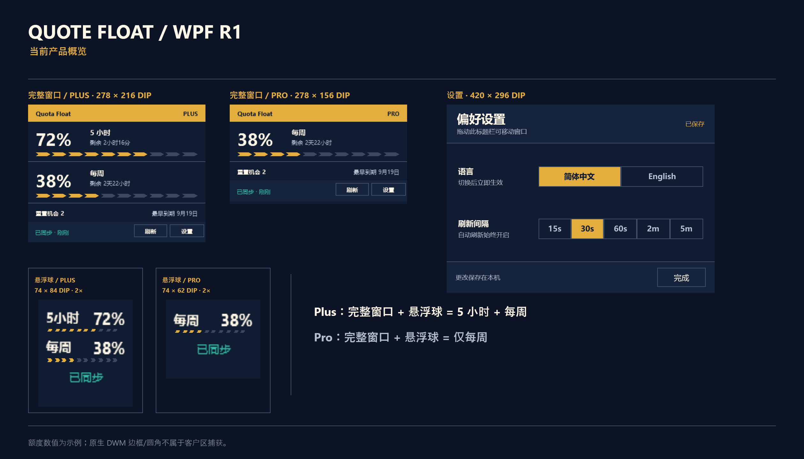

# Codex Quota Float for Windows

**语言 / Language:** [English](README.md) · 简体中文（当前）

[](https://github.com/keida/codex-quota-float/releases)

统计 R1 与 R2 所有 Release 资产的下载量（包括校验文件），不代表独立用户/安装数，也不是 R2 单独下载量。Shields.io 缓存可能导致数字延迟更新。

Codex Quota Float 有两个独立的 Windows 实现：稳定版 **WPF R1** 与 Beta 预发布版 **Tauri R2**。两者的界面和生命周期不同；R2 不替代 R1。

## R2 界面预览——PRO LITE 示例


> **AI 生成的产品示意图，数据为示例，并非原生应用截图。** 它不展示实际运行行为，也不构成视觉验收。PRO LITE 示例展示一个接口返回的周窗口；这不表示所有 PRO 账户都只有周窗口。R2 按每次响应返回的时长和值显示。本文未发布 R2 原生截图。

<details>
<summary>PLUS 示例——示意性的 5 小时与周窗口</summary>


> AI 生成的示意图及样例数据，不是原生截图，也不代表运行或视觉验收。5 小时与周窗口仅为示例，并不保证所有 PLUS 账户都返回这些窗口；R2 按接口实际返回的时长和值显示。

</details>

## 选择版本

| 产品线 | 状态 | 下载 | SHA-256 |
| --- | --- | --- | --- |
| WPF R1 `v1.1.3` | 稳定版，当前 Latest | [Windows x64 EXE](https://github.com/keida/codex-quota-float/releases/download/v1.1.3/Quote.Float.exe) | [发布说明](https://github.com/keida/codex-quota-float/releases/tag/v1.1.3) |
| Tauri R2 `2.0.0-beta.1` | Beta 预发布版，不是稳定版替代品 | [Windows x64 EXE](https://github.com/keida/codex-quota-float/releases/download/v2.0.0-beta.1/Codex-Float-R2-2.0.0-beta.1-windows-x64.exe) · [预发布页](https://github.com/keida/codex-quota-float/releases/tag/v2.0.0-beta.1) | [SHA256SUMS.txt](https://github.com/keida/codex-quota-float/releases/download/v2.0.0-beta.1/SHA256SUMS.txt) |

R2 EXE 大小为 20,928,512 字节，SHA-256：`5BF6AAFB87791556F543863FF7D8691CA363CFB2727A4351DB00A9C2FF36099A`。它未签名、未打包，属于启用 custom-protocol 的 debug-profile 构建，并非自包含安装程序。R2 需要 Windows x64、Microsoft Edge WebView2 Runtime、可用的本地 Codex 身份验证和网络连接。日常使用无需 .NET、Node.js、Rust 或 Visual Studio 工具。请遵循 Windows 或组织安全策略，不要盲目绕过安全警告。

## R2 快速开始

1. 从上方预发布页下载 R2 EXE 和 `SHA256SUMS.txt`，运行前按发布的校验值核对 EXE。
2. 运行 EXE。额度请求需要可用的本地 Codex 身份验证和网络；无需启动 Codex Desktop。
3. 若应用无法启动，请检查 Microsoft Edge WebView2 Runtime 是否已安装。此 Beta 尚未验证干净机器上的可移植性。

## R2 操作方式

- 浮窗以 96×96 DIP 紧凑状态启动；悬停可展开额度详情，离开浮窗后恢复紧凑状态。编辑期间 Settings 会保持打开，可通过 Done 或 Escape 关闭。
- 手动刷新请使用展开界面标题栏中的 Refresh，或托盘菜单；96×96 紧凑界面没有 Refresh 按钮。托盘操作为 Open、Refresh、Exit。窗口配置为不在任务栏单独显示按钮。
- 关闭 R2 窗口只会隐藏应用；托盘 Exit 才会退出。R2 不启动或监控 Codex Desktop，也不会因 Codex 关闭而自动退出。
- 手动额度刷新成功时显示 **“额度已更新”**。部分更新、过期数据、数据不可用和刷新失败分别有不同反馈。**“需要登录”**和**“请求受限”**是额度可用性状态，不是单独的手动刷新成功反馈。缺失字段表示未知，不等于零。

## R2 设置与数据解读

| 设置或数据 | 含义 |
| --- | --- |
| 外观 | System 跟随 Windows 应用颜色设置；也可选 Light 或 Dark。 |
| 语言 | English 或简体中文。 |
| 刷新间隔 | 60、120 或 300 秒。发生失败时会退避，并遵守适用的服务器 `Retry-After`；因此不能保证严格按固定间隔请求。 |
| 额度窗口 | 时长和值来自接口返回数据；标签不代表计费或套餐权益。 |
| 套餐徽标 | 返回标识映射为 `PRO LITE`、`PLUS`、`PRO (MORE)` 或 `PRO (MAX)`。这些是界面标签，不是官方计费术语或权益声明。 |
| Token 活动 | 扫描本地 session 记录，按本地时间汇总为 12 个区间。缺失区间保持空白/未知；覆盖不全时总量是下限。仅使用 K/M 格式。Token 活动不是订阅额度消耗量的度量，也不是 ChatGPT 普通聊天用量或 API 用量。 |
| Reset credits | 只读信息；仅在返回字段有效时显示。未知/不可用不代表为零，应用不会执行额度操作。 |

R2 为额度请求读取本地身份验证数据，并扫描本地 session JSONL 记录获取 token 计数。此类文件可能包含对话内容字节；当前源码使用 token-count 字段，不会把 session 内容发送到产品服务器。当前源码没有产品 telemetry 或 analytics endpoint，但这不构成对未来版本的承诺。

### R2 故障排查与限制

若额度过期或不可用，请检查本地 Codex 身份验证和网络连接；退出登录、速率限制、部分数据、过期数据和不可用是不同状态。若应用无法启动，请检查 WebView2，并遵循本地安全策略处理未签名 Beta。广泛账户/服务覆盖、干净机器可移植性、多种 DPI 行为和完整交互矩阵仍未验证。本文的 AI 示意图不是原生截图或视觉验收。详见 [R2 README](https://github.com/keida/codex-quota-float/blob/codex/r2-release/r2-tauri/README.zh-CN.md)、[功能边界](https://github.com/keida/codex-quota-float/blob/codex/r2-release/r2-tauri/docs/r2/UPDATE-2026-10-17.md) 和 [验收记录](https://github.com/keida/codex-quota-float/blob/codex/r2-release/r2-tauri/docs/r2/ACCEPTANCE.md)。

<details>
<summary>WPF R1 界面（不是 R2）</summary>




_额度数值为示例；这些是 100% / 96 DPI 下的 WPF R1 捕获，不是 R2 截图。原生 DWM 边缘外观由操作系统合成，可能与捕获边界略有差异。_

</details>

## 稳定版 WPF R1——最新下载

**[Latest Release](https://github.com/keida/codex-quota-float/releases/latest)** · v1.1.3 · [下载自包含 Windows x64 EXE](https://github.com/keida/codex-quota-float/releases/download/v1.1.3/Quote.Float.exe) · [发布说明中的 SHA-256](https://github.com/keida/codex-quota-float/releases/tag/v1.1.3)

直接运行 `Quote.Float.exe`，无需单独安装 .NET。运行前请先用 v1.1.3 发布说明中的哈希值校验 SHA-256。当前版本未进行代码签名，Windows Defender SmartScreen 首次运行时可能显示警告；请使用上面的官方 Release 链接、完成哈希校验，再遵循你的 Windows 或组织安全策略，不要盲目绕过安全警告。

## WPF R1——核心功能

- **Codex 专用伴侣：**与已安装的 Codex Desktop 配合工作，需要时可以启动它，也可以只观察它的状态，并且不会关闭它。
- **完整窗口与悬浮球：**持续显示 Plus 或 Pro 额度，并保留 WPF R1 的边缘定位、悬停展开、托盘恢复和置顶行为。
- **English / 中文：**在设置中切换界面和托盘菜单语言；选择保存在本机。
- **本地优先：**只为受支持的 Codex usage 与 reset-credit 视图获取额度数据；当前源码不采集聊天内容，也没有产品分析 endpoint。

## WPF R1——Windows 要求

- Windows x64；使用 LaunchAndWatch 时需要安装 Codex Desktop。
- 已验证的原生基线是 Windows 100% / 96 DPI。
- Windows 125% / 150% 原生 DPI 运行验收仍为 **NOT VERIFIED / OUT OF R1 ACCEPTANCE SCOPE**。
- 已发布的 v1.1.3 EXE 是自包含版本，无需单独安装 .NET。

## WPF R1——隐私边界

Quote Float 从 `CODEX_HOME` 或用户 `.codex` 目录下的本地 Codex `auth.json` 读取 access token 与账户路由标识，仅用于额度请求。它只向以下 endpoint 发送带身份验证的 GET 请求：

- `https://chatgpt.com/backend-api/wham/usage`
- `https://chatgpt.com/backend-api/wham/rate-limit-reset-credits`

当前源码不读取聊天内容，不定义 telemetry 或 analytics endpoint，也不会把 Codex token 写入 Quote Float 偏好设置。Quote Float 会在本机 `%LOCALAPPDATA%\QuotaFloat\preferences.json` 保存语言和刷新间隔偏好。可选的 Edge Drag 诊断默认关闭；只有设置 `QF_EDGE_DRAG_LOG` 才会写入用户选择的本地文件。该文件可能包含时间戳、窗口/显示器边界和窗口句柄；不会自动上传。公开分享前请先检查并脱敏。不要在公开 issue 中附加 `auth.json`、token、cookie、原始响应、账户截图或私人诊断信息。

## WPF R1——校验下载

在下载的 `Quote.Float.exe` 所在目录运行，将其 SHA-256 与 [v1.1.3 发布说明](https://github.com/keida/codex-quota-float/releases/tag/v1.1.3)中的值进行比较：

```powershell
$expected = 'D3F3F2D30662B1C93D973BA68AADA0498E7860245A8325546BE596A3E605E385'
$actual = (Get-FileHash .\Quote.Float.exe -Algorithm SHA256).Hash
if ($actual -ne $expected) { throw 'Checksum mismatch' }
"SHA-256 OK: $actual"
```

## WPF R1——快速开始

1. 从官方 [v1.1.3 Release](https://github.com/keida/codex-quota-float/releases/tag/v1.1.3) 下载 `Quote.Float.exe`；SHA-256 包含在该版本的发布说明中。
2. 使用上面的 PowerShell 片段校验 EXE。
3. 运行 EXE。使用 `--direct` 独立启动浮窗，使用 `--watch` 只观察 Codex 而不启动它。不带模式参数时使用已批准的 LaunchAndWatch 行为。

## WPF R1——产品契约

- Settings 是固定 `420 × 296 DIP` 的非模态窗口；用户可选择语言和刷新间隔，Done 用于关闭窗口。
- 已保存/说明文字不是设置状态。Settings 没有 Refresh 按钮；唯一的手动 Refresh 在 Full 页脚。Auto Refresh 始终开启。
- 刷新会保留已有额度；没有已有快照时，活动请求显示 Loading。
- R1 不包含 Product Scale、Billing/Usage 导航、Auto Refresh 开关、Click-through 或主题/行为选择器。

## WPF R1——技术验收

- [公开 Roadmap](ROADMAP.md)
- [验收摘要](docs/wpf-r1/ACCEPTANCE-SUMMARY.md)
- [发布说明](docs/wpf-r1/RELEASE-NOTES-R1.md)
- [开发说明](docs/DEVELOPMENT.md)
- [当前候选 manifest](docs/wpf-r1/CANDIDATE-MANIFEST.json)
- [安全报告](SECURITY.md)
- [许可证](LICENSE)
- [第三方说明](THIRD_PARTY_NOTICES.md)

[](https://github.com/keida/codex-quota-float/actions/workflows/wpf-ci.yml)

当前 v1.1.3 版本已通过 WPF Release 构建与确定性测试。以下事项仍明确保持 **NOT VERIFIED / OUT OF R1 ACCEPTANCE SCOPE**：

1. 同一真实 Pro 账户 `Fresh -> SignedOut -> Fresh`。
2. 隔离 Codex `Present -> close -> three absence confirmations -> Quote Float response -> restart/recovery`。
3. 原生 Windows 125% / 150% DPI 运行验收。

## 仓库结构

- `wpf/`：当前 WPF 产品实现及 WPF 测试。
- `docs/`：公开技术记录、契约、验收证据和发布记录。
- `native/`：保留作参考的历史 WinForms 实现，不是当前产品实现。

OpenAI、Codex、Microsoft 和 Windows 名称仅用于说明兼容目标；不代表任何关联或背书。v1.1.3 是当前 Latest Release；v1.1.2 是此前的已发布版本，v1.1.1 tag 未发布且已被取代。
