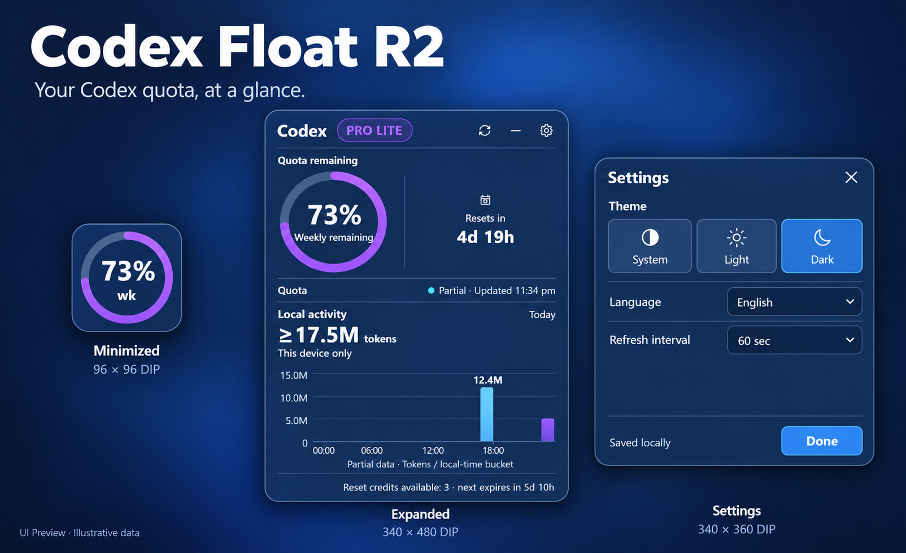
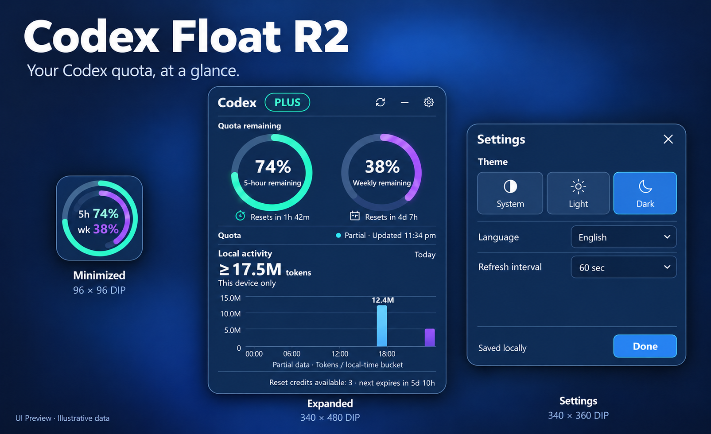

# Codex Float R2

**Version:** `2.0.0-beta.1` · **Status:** published GitHub prerelease (not stable); R1 v1.1.3 remains Latest.

Counts all assets across R1 and R2 releases, including checksum files—not unique users/installations or R2-only downloads. Shields.io caching may delay updates.

Codex Float R2 is a Windows desktop companion that shows Codex quota and locally observed token-count activity in a compact floating window. It is a separate Tauri 2 / Rust / React + TypeScript implementation; it does not replace the WPF R1 line.

## UI Preview — PRO LITE example

> **AI-generated product illustration with illustrative data; not a native application screenshot.** It does not show runtime behavior or constitute visual acceptance. The PRO LITE example depicts one returned weekly window; it does not claim that all PRO accounts return only a weekly window. R2 follows durations and values in each response. This page does not publish native R2 screenshots.

PLUS example — illustrative 5-hour and weekly windows

> AI-generated illustration with sample data, not a native screenshot or runtime/visual acceptance. The 5-hour and weekly windows are examples, not a guarantee for every PLUS account; R2 follows returned durations and values.

## Downloads

R1 v1.1.3 remains the project's stable Latest release: [download and verify it from GitHub](https://github.com/keida/codex-quota-float/releases/tag/v1.1.3). R2 `2.0.0-beta.1` is published as a prerelease, not a stable replacement. [Open the R2 prerelease](https://github.com/keida/codex-quota-float/releases/tag/v2.0.0-beta.1), [download the Windows x64 EXE](https://github.com/keida/codex-quota-float/releases/download/v2.0.0-beta.1/Codex-Float-R2-2.0.0-beta.1-windows-x64.exe), or download [SHA256SUMS.txt](https://github.com/keida/codex-quota-float/releases/download/v2.0.0-beta.1/SHA256SUMS.txt). The asset is 20,928,512 bytes with SHA-256 `5BF6AAFB87791556F543863FF7D8691CA363CFB2727A4351DB00A9C2FF36099A`. It is unsigned, unpackaged, and a custom-protocol debug-profile build; it is not a signed installer or self-contained app. R2 requires Windows x64, WebView2, usable local Codex authentication, and network access. See [Acceptance](docs/r2/ACCEPTANCE.md) for evidence and limits.

## What R2 currently does

- Shows a 96×96 DIP compact widget; hover expands quota details and leaving the surface returns it to compact. Settings stays open while being edited and is closed through its normal Done/Escape controls.
- Reads current quota and reset-credit data from the Codex usage views implemented in the source. Manually refresh from the expanded view's header or the tray menu; the compact 96×96 view has no Refresh button. Manual feedback distinguishes “Quota updated,” partial, stale, unavailable, and failed results. Signed-out and rate-limited are quota availability states, not separate manual-feedback messages. Missing or unavailable fields are not zero values.
- Shows the current returned plan identifier as `PRO LITE`, `PLUS`, `PRO (MORE)`, or `PRO (MAX)` for the recognized identifiers `prolite`, `plus`, `pro`, and `promax` (case-insensitive). Unknown identifiers remain readable; the label does not infer quota windows, billing, or price.
- Offers English and Simplified Chinese, and System / Light / Dark themes. System uses the native window theme reported by Windows, which follows the Windows app-color setting.
- Settings currently expose theme, language, and 60 / 120 / 300-second refresh intervals; the source does not implement Follow Codex, low-quota alerts, or an About page.
- Offers tray Open, Refresh, and Exit actions; the app window is configured not to add a taskbar button.
- Reads local Codex session JSONL records for cumulative token-count activity and plots twelve local-time buckets for the day. Window durations use returned data; missing buckets remain blank/unknown. The displayed total is a lower bound when coverage is partial, formatted in K/M (not B). It is token activity, not quota consumed.

Reset-credit details are informational only: values appear only when valid returned fields are available. An unknown or unavailable balance is not a zero, and the display does not perform or promise a credit action.

These are source-backed capabilities, not a claim of complete Plus/Pro feature parity or full account/provider coverage. The R2 source does not use a Codex app-server and does not provide real-time approval/session control, prediction, reminders, or “follow Codex” behavior.

The pinned [Codex auth source](https://github.com/openai/codex/blob/ce0323f2f2d3b25e82806cd555237da3db4e1897/codex-rs/protocol/src/auth.rs#L130-L145) displays `KnownPlan::ProLite` as the generic name `Pro`. R2 deliberately renders the raw `prolite` identifier as `PRO LITE` so it remains distinct from raw `pro`, shown as `PRO (MORE)`. These are R2 UI labels, not upstream billing terms or claims about entitlements. The current-source update, R1/R2 comparison, requirements, privacy boundaries, and known limits are summarized in [Update — 2026-10-17](docs/r2/UPDATE-2026-10-17.md).

R2 has an independent lifecycle: it does not monitor Codex Desktop or automatically exit when Codex closes. Closing the R2 window hides it; use tray Exit to quit. Its quota path reads local authentication data and makes direct authenticated HTTP requests rather than requiring a running Codex process. Missing/invalid authentication and request failures are represented as quota availability states. These are source-level behaviors, not a claim that every no-Codex or network-failure scenario received a native test.

## Data and privacy boundary

The native source reads local Codex authentication data from `CODEX_HOME` or the default `.codex` directory to request quota. It sends authenticated requests to the two ChatGPT usage endpoints documented in [Security](../SECURITY.md). It also scans bounded portions of local `sessions/*.jsonl` data to find cumulative token-count fields. Because those files contain session records, this is **not** a promise that the program never reads or inspects conversation-bearing bytes. The current parser uses token-count records for its chart; it does not send session-file content to a product server.

At this source version there is no product telemetry or analytics endpoint. That is a statement about this version’s source, not a promise about future versions. Token counts are not quota percentages. The token-activity chart does not measure Codex subscription quota consumed; R2 does not monitor ordinary ChatGPT chats or API usage, and it does not independently establish plan entitlements or prices. No account data, token, session file, or raw response is included in this source branch’s public documentation or release asset. The image on this page and the root README is an AI-generated illustration only; this page does not publish native R2 screenshots or establish broad visual acceptance.

Read [the R2 data-boundary details](../SECURITY.md#r2-beta-source-data-boundary) before using a preview build.

## Running the desktop candidate

The candidate is supplied as one unpackaged EXE, but it is **not self-contained**: it requires Windows x64, the Microsoft Edge WebView2 Runtime, a usable local Codex authentication file, and network access for quota requests. Running it does not require users to install .NET, Node.js, Rust, or Visual Studio Build Tools. Most supported Windows devices may already have WebView2, but do not assume it is present on every device; see [Microsoft’s WebView2 distribution guidance](https://learn.microsoft.com/microsoft-edge/webview2/concepts/distribution). Fresh-machine portability of this beta candidate has not been verified.

## Quick use and troubleshooting

Launch the downloaded EXE, allow the initial quota request to finish, and use Refresh in the widget or tray when you want a manual update. Closing the window hides R2; choose tray Exit to quit. In Settings, choose System / Light / Dark, English / 简体中文, and a 60-, 120-, or 300-second refresh interval. If quota is unavailable or stale, check that the local Codex authentication is usable and network access is available; signed-out, rate-limited, partial, and unavailable results are distinct states, not zero quota. If the app does not start, check for the Microsoft Edge WebView2 Runtime and follow local Windows security policy for this unsigned beta.

## Build and verify

See [Development](docs/r2/DEVELOPMENT.md) for Windows prerequisites and source build commands, and [Acceptance](docs/r2/ACCEPTANCE.md) for observed results and remaining gaps. The source uses the system WebView2 runtime. The current Tauri bundle is intentionally inactive: builds are unpackaged executables, unsigned, with no installer or updater.

## R2 documents

- [Changelog](docs/r2/CHANGELOG.md)
- [Development and icon generation](docs/r2/DEVELOPMENT.md)
- [Acceptance and limits](docs/r2/ACCEPTANCE.md)
- [Update — 2026-10-17](docs/r2/UPDATE-2026-10-17.md)
- [简体中文 README](README.zh-CN.md)

OpenAI, Codex, ChatGPT, Microsoft, and Windows identify compatibility targets; no affiliation or endorsement is implied.
